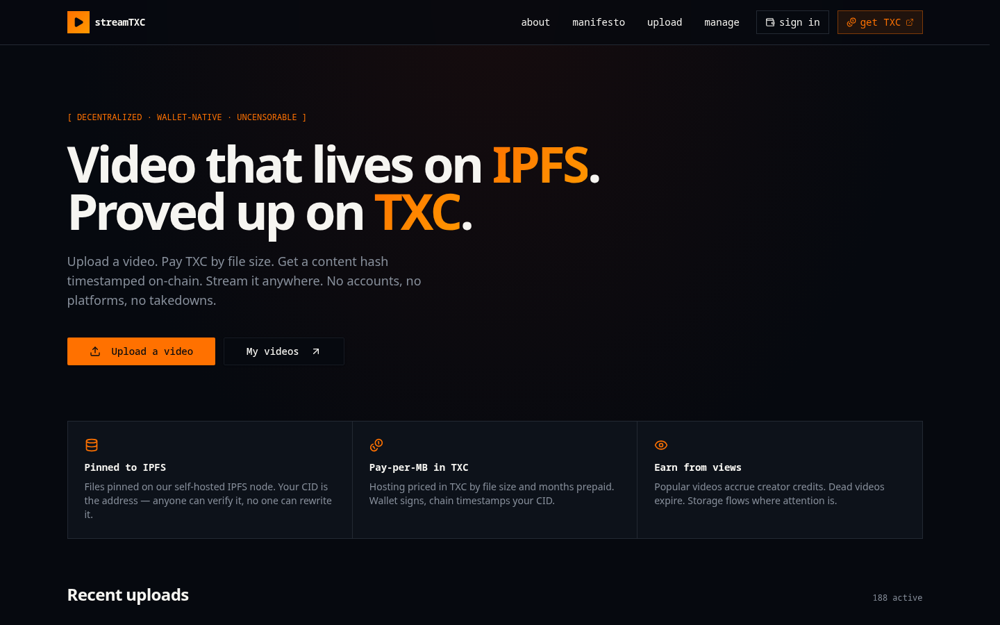
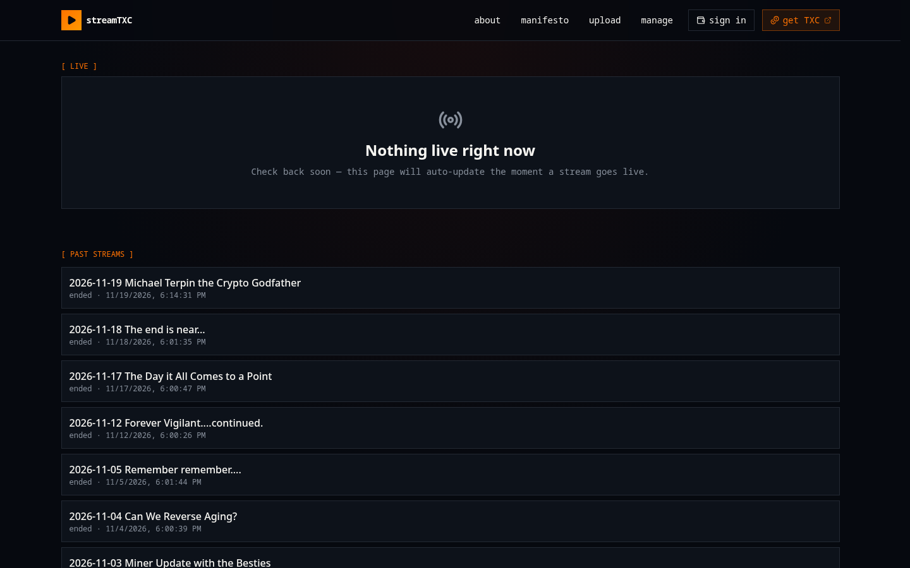
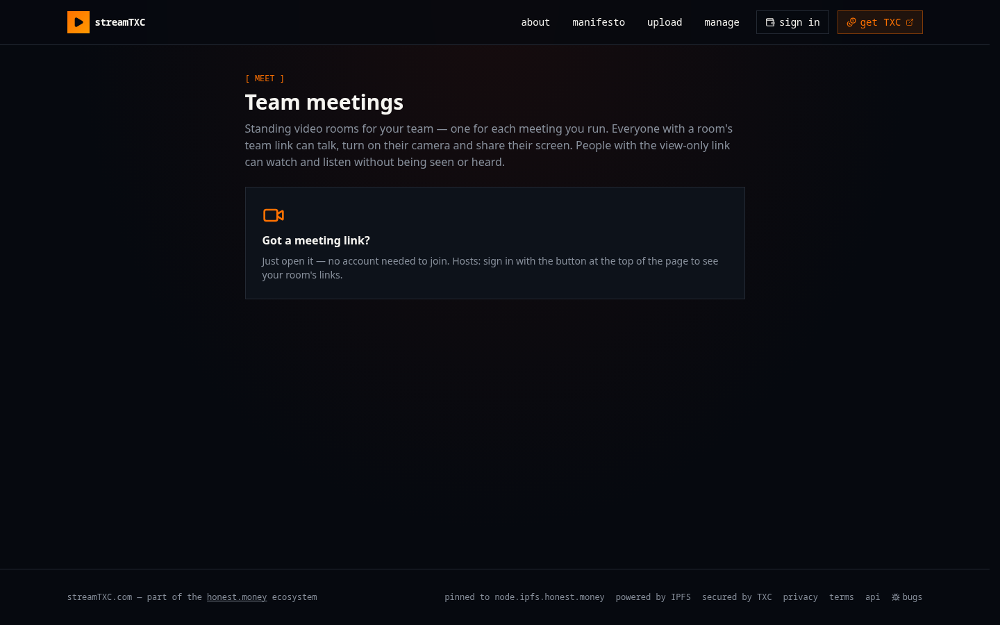
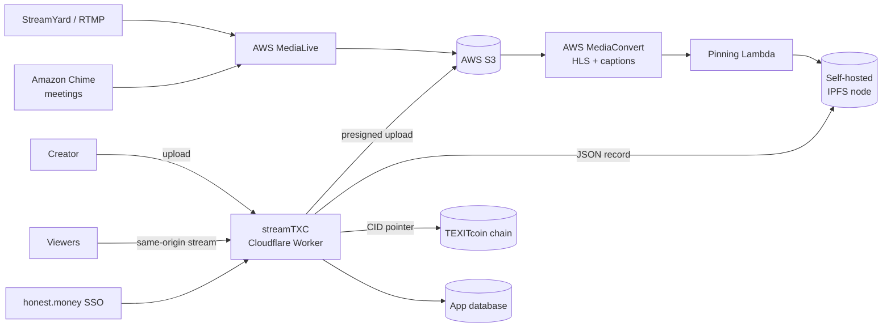

<div align="center">


# streamTXC

### Video that lives on IPFS. Proved up on TXC.

**Upload a video, pay in TXC, get a permanent content address stamped on-chain, and stream it anywhere.**
No platform lock-in. No silent takedowns. Every receipt is on the blockchain.

[**▶ Watch live at streamtxc.com**](https://streamtxc.com) &nbsp;·&nbsp;
[About](https://streamtxc.com/about) &nbsp;·&nbsp;
[Manifesto](https://streamtxc.com/manifesto) &nbsp;·&nbsp;
[API](https://streamtxc.com/api) &nbsp;·&nbsp;
[Part of honest.money](https://honest.money)


<br />



</div>

---

## Why streamTXC?

Normal video sites own your files, your audience and your receipts. streamTXC flips that:

| | Normal video sites | streamTXC |
|---|---|---|
| **Where your video lives** | Their servers | IPFS — addressed by its own fingerprint (CID) |
| **Proof you published it** | Their database | A TEXITcoin transaction anyone can check |
| **Who owns the video** | The platform | Your wallet — filed in your own HME Wallet branch |
| **Who gets paid** | Mostly the platform | **90%** to the creator, 5% hosting, 5% platform |
| **Account needed** | Email + password | Sign in with [honest.money](https://honest.money) or your wallet |

---

## ✨ What it does

### 🎬 Video hosting on IPFS
- Upload once — get an adaptive HLS stream (multiple qualities) pinned to our own IPFS node.
- Pay in **TXC by file size and months prepaid**. Renew one video or a whole batch at once.
- Friendly reminders on Telegram at 7, 3 and 1 day before expiry, plus a **30-day grace period** to restore.
- Copy-paste **embed codes** with mute, autoplay, start time and size options.
- **Closed captions** and full transcripts, generated automatically.

### ⛓️ On-chain proof
- Every important event (upload, ownership, payments) is written as a full JSON record on IPFS,
  with a tiny pointer stamped on the TEXITcoin chain — the same pattern used by File Fingerprint.
- Each video gets its own owner address on the creator's **HME Wallet branch 1105**, so the
  ownership record lives in *their* wallet, not ours.

### 🔴 Live streaming
- Go live from StreamYard (or any RTMP tool) through AWS MediaLive.
- Traffic-light status, one-click warm-up and auto warm-up before scheduled shows.
- Streams are **archived automatically** to IPFS when they end — with the warm-up minutes trimmed off.
- Embeddable live players per stream or per channel.

<p align="center"></p>

### 👥 Team meetings — `/meet`
- Google Meet–style rooms for ~10+ people: talk, mute, cameras, screen sharing.
- **Team links** for participants and **view-only links** for audiences.
- Waiting room with manual or automatic approval, join sounds, named rooms ("Daily Executive Meeting").
- Recording, live transcription and **AI meeting notes** — private until the host publishes.
- One click to **send the meeting to your live stream**.
- Billed fairly from a prepaid TXC balance, only for people who are actually connected.

<p align="center"></p>

### 💬 Community & earnings
- Comments, boosts and live chat paid in TXC, split **90 / 5 / 5** automatically.
- Creator payouts are held safely until ownership is proven, then released.

---

## 🧭 How it fits together



---

## 🛠️ Tech stack

| Layer | What we use |
|---|---|
| App framework | [TanStack Start](https://tanstack.com/start) · React 19 · Vite 7 |
| Styling | Tailwind CSS v4 · shadcn/ui |
| Hosting | Cloudflare Workers (edge) |
| Database & auth | Lovable Cloud |
| Identity | [honest.money](https://honest.money) SSO · HME Wallet QR sign-in (BIP-322 / signed messages) |
| Blockchain | [TEXITcoin](https://texitcoin.org/build) — OP_RETURN records, watch-only xpub derivation |
| Storage | Self-hosted IPFS (kubo) on AWS EC2 |
| Video | AWS MediaConvert, MediaLive, S3, Lambda |
| Meetings | Amazon Chime SDK |
| AI | Captions, transcripts and meeting notes via the Lovable AI Gateway |

---

## 🚀 Running it locally

```bash
bun install
bun run dev        # http://localhost:8080
bun test src/lib   # rules & security tests
```

The `.env` file only holds **public** values (the database address and its publishable key).
Every private setting — AWS keys, TXC node credentials, IPFS keys, signing secrets — lives in the
hosting platform's secret store and is **never committed**.

Infrastructure setup guides:
- [`AWS_SETUP.md`](AWS_SETUP.md) — MediaConvert + S3 transcoding
- [`docs/ipfs-aws/`](docs/ipfs-aws/README.md) — IPFS node + pinning Lambda + MediaLive

---

## 🔐 Security

streamTXC has been through two in-depth security audits, with fixes for ownership hijacking,
payment confirmation, meeting billing abuse, media sandboxing, session revocation and more.
A few principles the code sticks to:

- **Ownership comes from wallet signatures**, never from an email address or anything the browser claims.
- **Payments count only once they're confirmed on-chain.**
- **Uploaded files can never run code** on the site — media is served with strict, inert headers.
- **No private keys ever reach the browser.** Visitors watch through same-origin streams.

Found something? Please see [`SECURITY.md`](SECURITY.md) — don't open a public issue.

---

## 🌐 The Honest Money Ecosystem

streamTXC is part of the **[Honest Money Ecosystem](https://honest.money)** — the umbrella for the
TXC, ISK and ZCU networks and the coins, wallets, tools and apps built on them.

- ⛏️ [TEXITcoin](https://texitcoin.org/build) — the chain behind every receipt
- 🧊 [Zero Chill (ZCU)](https://zerochill.com/build)
- 🔑 [honest.money](https://honest.money) — single sign-on, wallets and ecosystem APIs

---

<div align="center">

**[streamtxc.com](https://streamtxc.com)** · [Terms](https://streamtxc.com/terms) · [Privacy](https://streamtxc.com/privacy) · [Manifesto](https://streamtxc.com/manifesto)

Built with [Lovable](https://lovable.dev) · Part of the [honest.money](https://honest.money) ecosystem

</div>
